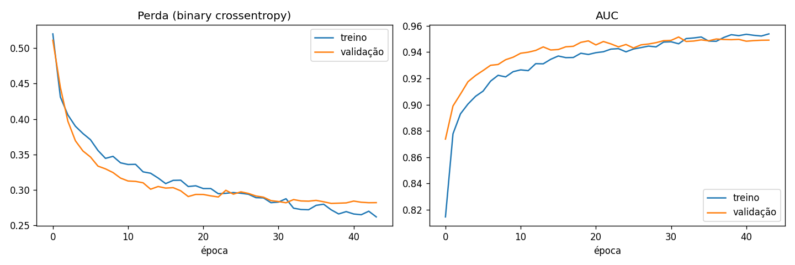
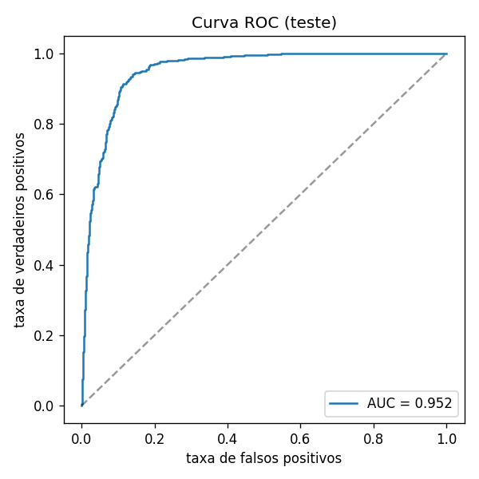
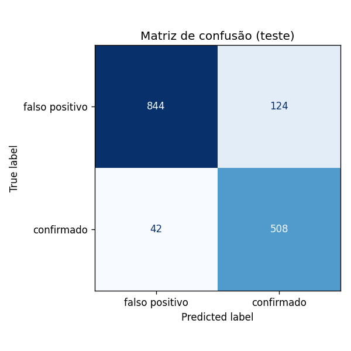

# 🪐 ExoHunter

**Machine Learning e IA aplicados à astrofísica.**
Detecção de exoplanetas a partir de dados do telescópio espacial **Kepler**
(NASA), usando uma rede neural para distinguir planetas confirmados de
falsos positivos.

Inspirado no trabalho que inaugurou deep learning na área
([Shallue & Vanderburg, 2018 — *Astronet*](https://ui.adsabs.harvard.edu/abs/2018AJ....155...94S/abstract)).

---

## 🎯 O problema

O telescópio Kepler observou centenas de milhares de estrelas procurando
pequenas quedas de brilho — os **trânsitos** que ocorrem quando um planeta
passa na frente da sua estrela. Cada sinal detectado vira um *Kepler Object
of Interest* (KOI), que é depois classificado como:

- **CONFIRMED** — exoplaneta confirmado ✅
- **FALSE POSITIVE** — sinal causado por outra coisa (estrela binária,
  ruído instrumental etc.) ❌
- **CANDIDATE** — ainda sem veredito (descartado neste modelo)

A tarefa: **dado os parâmetros físicos do trânsito e da estrela, prever se o
KOI é um exoplaneta confirmado ou um falso positivo.**

## 🛰️ Dados

Fonte: [NASA Exoplanet Archive](https://exoplanetarchive.ipac.caltech.edu/),
tabela cumulativa de KOIs, acessada via **API TAP** (aberta, sem chave).

- 9.564 KOIs no total → 7.587 rotulados (2.748 confirmados + 4.839 falsos
  positivos) usados no treino/avaliação.
- 12 features físicas: período orbital, duração/profundidade do trânsito,
  raio planetário, temperatura de equilíbrio, SNR, e parâmetros da estrela
  hospedeira (temperatura, gravidade, raio, magnitude).

> ⚠️ **Sem vazamento de informação:** deixamos de fora `koi_score` e os flags
> `koi_fpflag_*` de propósito, pois derivam diretamente da vetagem que decide
> o rótulo. O modelo aprende só da física.

## 🧠 Modelo

Rede neural densa (MLP) em **TensorFlow/Keras**: camadas `Dense` com
`BatchNormalization` e `Dropout`, saída sigmoide. Treino com `class_weight`
balanceado, `EarlyStopping` e `ReduceLROnPlateau`.

### Resultados (conjunto de teste, 1.518 KOIs)

| Métrica | Valor |
|---|---|
| **AUC** | **0.952** |
| Acurácia | 0.891 |
| Recall (confirmados) | 0.924 |
| Precisão (confirmados) | 0.804 |
| Precisão (falsos positivos) | 0.953 |

### Gráficos

**Histórico de treino** — evolução da perda e da AUC ao longo das épocas,
em treino e validação (sem overfitting relevante, graças ao `EarlyStopping`):



**Curva ROC** — capacidade de separar confirmados de falsos positivos no
conjunto de teste (AUC = 0.952):



**Matriz de confusão** (teste):



> As figuras são regeradas a cada treino em `reports/figures/` (não
> versionadas). As cópias em `docs/img/` são os instantâneos exibidos aqui.

## 📁 Estrutura

```
exohunter/
├── app.py                  # dashboard Streamlit
├── src/
│   ├── config.py           # caminhos, features e hiperparâmetros
│   ├── data_collection.py  # coleta via API TAP da NASA
│   ├── preprocessing.py    # limpeza, split estratificado, padronização
│   ├── model.py            # arquitetura da rede neural (Keras)
│   ├── train.py            # treino, avaliação e geração de artefatos
│   └── predict.py          # classifica todos os KOIs -> predictions.csv
├── data/                   # dados brutos/processados (não versionados)
├── models/                 # modelos e métricas salvos (não versionados)
├── reports/figures/        # gráficos gerados
├── requirements.txt
└── CHANGELOG.md
```

## 🚀 Como rodar

```bash
pip install -r requirements.txt   # instalar dependências
python -m src.data_collection     # baixar os dados da NASA
python -m src.train               # treinar e avaliar
python -m src.predict             # classificar todos os KOIs
streamlit run app.py              # abrir o dashboard
```

Artefatos ficam em `models/exoplanet_mlp.keras` e `models/metrics.json`.

## 🖥️ Dashboard

Interface em **Streamlit** (`app.py`) para acompanhar o processo e explorar as
classificações. Três abas:

- **Visão geral do processo** — distribuição real × classificação do modelo,
  matriz de confusão, acurácia e AUC.
- **Planetas classificados** — tabela filtrável (por disposição, classe do
  modelo, probabilidade e nome), dispersão raio × período e export CSV.
- **Candidatos promissores** — os candidatos sem veredito que o modelo aponta
  como prováveis exoplanetas, ordenados por probabilidade.

O dashboard lê apenas os artefatos gerados (`data/processed/predictions.csv`,
`models/metrics.json`) — não carrega o TensorFlow.

## 🗺️ Próximos passos

- **Fase 2 — curvas de luz:** 1D CNN sobre as séries temporais de fluxo reais
  (via MAST/`lightkurve`), o verdadeiro *Astronet*.
- Ajuste de hiperparâmetros com `keras-tuner`.
- Notebook de análise exploratória (EDA) dos KOIs.

## 🔧 Fluxo de desenvolvimento (gitflow)

- `main` — versões liberadas (com tag SemVer).
- `develop` — integração.
- `feature/*` — desenvolvimento de cada funcionalidade, mesclado em `develop`.

Versionamento documentado em [CHANGELOG.md](CHANGELOG.md).
